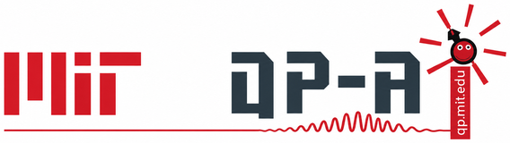

#  PixCell

*From Pixels to PCells: A Neurosymbolic Approach to Photonic Component Creation* ([arXiv:XXXX.XXXXX](https://arxiv.org/abs/XXXX.XXXXX))

https://github.com/user-attachments/assets/cfb10bed-8854-48a5-a326-6e8657b4e34a

## Install

```bash
# Claude Code, Codex, or Cursor
npx plugins add QPG-MIT/PixCell

# Claude Code, using its native plugin manager
claude plugin marketplace add QPG-MIT/PixCell && claude plugin install pixcell@pixcell

# Local browser Studio, without cloning the repository
uvx --from 'pixcell[workbench] @ git+https://github.com/QPG-MIT/PixCell' pixcell studio
```

**Reproducing the paper, or developing?** Clone the repo; it carries the
locked environment, briefs, fixtures, benchmark record, and tests:

```bash
# no uv yet?  curl -LsSf https://astral.sh/uv/install.sh | sh
git clone https://github.com/QPG-MIT/PixCell && cd PixCell
uv sync                        # or ./setup.sh (macOS + Linux)
uv run pixcell doctor          # preflight: what can run here, what to add
```

Requires Python 3.11-3.13 (3.13 recommended). The core loop uses no API key:
recreation, verification, gating, the workbench, and the Studio light table
all run locally. `GEMINI_API_KEY` is used only to standardize an extracted
paper figure; drawn devices do not need it. `TIDY3D_API_KEY` is used only for
cloud FDTD. See [`.env.example`](.env.example).

## How to use

Use the entry point that matches the installation above: the plugin inside a
coding agent, Studio for interactive work, or the CLI from a clone for scripts
and individual stages. Start with a paper figure, drawing, or existing device
and state the component, target PDK or layer stack, and any geometric or
optical constraints. Successful recreations return a gate-verified GDS, its
parametric source, and a fidelity score.

### Coding agent

Open Claude Code, Codex, or Cursor in the project where you want the output.
PixCell appears as a `homi` full-pipeline skill plus stage-specific skills.
Ask directly and let the agent choose, or invoke a skill for explicit control:

> *"Here's a paper. Recreate the ring resonator in figure 3."*
> *"Hit an 8 nm FSR on 400 nm nitride."*
> *"Show me the device. I want to play with the knobs."*

### Studio

[Try the hosted Studio](https://pixcell.qpaig.com/new) with no installation
(trusted beta), or launch it locally with the `uvx` command in
[Install](#install). From a clone:

```bash
uv run pixcell studio
```

Drop in a paper or sketch and describe the result you want. The local Studio
opens [`projects/example_mmi_splitter/`](projects/example_mmi_splitter/) by
default—a drawn 1×4 MMI gate-verified at IoU 0.995—so its geometry, parameters,
and live fidelity are visible before starting your own device.

### CLI

From a clone, use the CLI for scripts or stage-level control. `homi` and
`pixcell` are aliases; prefix commands with `uv run` unless the environment is
active:

```bash
pixcell extract paper.pdf -o projects/my_device    # figure → silhouette + footprint
pixcell generate projects/my_device                # blind agent recreation + gate
pixcell retarget device.py --stack sin400.json --spec spec.json
pixcell explore  projects/my_device/output/best.py --launch   # per-device workbench
pixcell simulate projects/my_device/output/best.gds  # FDTD draft; a human presses Start
pixcell serve                                      # the 7 MCP servers · `pixcell api` for REST
```

## Dataset

The released L0–L4 image-to-code curriculum is available as
[`qpaig-mit/pixcell`](https://huggingface.co/datasets/qpaig-mit/pixcell).
Its dataset card includes loading examples, the schema, and reproducibility
commands.

## Structure

```text
.
├── assets/                       README branding and the method film
├── dataset/                      Accepted-only L0-L4 image-to-code curriculum
│   ├── data/{l0,...,l4}/         One Parquet training shard per curriculum level
│   ├── factory/
│   │   └── core-v1/              Frozen 738-row source capsule and rebuild manifests
│   ├── galleries/                Visual overview of the full release and each level
│   ├── metadata/                 Catalog, checksums, audits, and source reports
│   └── scripts/                  Deterministic build, validation, render, and export tools
├── .env.example                  Optional API-key template; the core loop needs none
├── LICENSE                       Repository-wide MIT license
└── README.md                     Project overview, installation, and entry points
```

## License

[MIT](LICENSE).
