# PixCell System Architecture

> **Photonic Multimodal Intelligence** - Converting research papers into fabrication-ready GDS files. PixCell is the system (what you install); `homi` is its engine (what you import).

---

## Table of Contents

1. [Master Pipeline Overview](#1-master-pipeline-overview)
2. [Integration Layer Architecture](#2-integration-layer-architecture)
3. [Michaelangelo Engine](#3-michaelangelo-engine---gds-generation)
4. [JEE Engine](#4-jee-engine---parameter-optimization)
5. [MJ Engine](#5-mj-engine---paper-processing)
6. [Weber Engine](#6-weber-engine---script-analysis--device-workbench)
7. [Model Client Architecture](#7-model-client-architecture)
8. [MCP Server Layer](#8-mcp-server-layer)
9. [Calibration & Metrics System](#9-calibration--metrics-system)
10. [Project Structure](#10-project-structure)
11. [Data Flow Reference](#11-data-flow-reference)
12. [Complete Tool Reference](#12-complete-tool-reference)

---

## 1. Master Pipeline Overview

The complete end-to-end pipeline from research paper to simulation-ready GDS.

```mermaid
flowchart TB
    subgraph INPUT["📄 INPUT"]
        PDF[/"Research Paper<br/>(PDF)"/]
        DRAW[/"Manual Drawing<br/>(PNG/JPG)"/]
    end

    subgraph STEP1["Step 1: Upload"]
        UP[Upload Source]
        PROJ[(Project<br/>Directory)]
    end

    subgraph STEP2["Step 2: Select Device"]
        EXT[Extract Images<br/>from PDF]
        SCORE[Score Images<br/>for Device Content]
        SEL1[User Selects<br/>Best Device Image]
    end

    subgraph STEP3["Step 3: B&W Conversion"]
        GEN[Generate B&W<br/>Variants]
        REF[Refine with<br/>Custom Instructions]
        SEL2[Select Best<br/>B&W Variant]
    end

    subgraph STEP3_5["Step 3.5: Confirm Device"]
        CONF[Confirm Device<br/>& Extract Footprint]
    end

    subgraph STEP4["Step 4: Footprint"]
        GEM[Gemini Vision<br/>Extraction]
        CONFIRM[Confirm<br/>Dimensions]
    end

    subgraph STEP5["Step 5: GDS Generation"]
        P1[Phase 1:<br/>Multi-Seed Exploration<br/>5-41 seeds × 2 turns]
        P2[Phase 2:<br/>Extended Iteration<br/>3-8 additional turns]
        BEST[Select Best<br/>Result by IoU]
    end

    subgraph STEP5_5["Step 5.5: Optimization"]
        JEE_DEC{Enable JEE<br/>Optimization?}
        GRID[Grid Search]
        OPT[Powell +<br/>Nelder-Mead]
        APPLY[Apply Optimized<br/>Parameters]
    end

    subgraph STEP6["Step 6: Results"]
        GDS[/"best.gds<br/>best.py"/]
        VIS[Visualization &<br/>Metrics Display]
    end

    subgraph STEP7["Step 7: Workbench"]
        AST[AST Script<br/>Analysis]
        SLOTS[Generate<br/>Slot System]
        WBENCH[marimo Device<br/>Workbench]
    end

    subgraph STEP8["Step 8: Simulation"]
        TIDY[Tidy3D<br/>Configuration]
        CLOUD[Upload to<br/>Cloud]
        FDTD[FDTD<br/>Results]
    end

    %% Main Flow
    PDF --> UP
    DRAW --> UP
    UP --> PROJ
    PROJ --> EXT

    EXT --> SCORE
    SCORE --> SEL1

    SEL1 --> GEN
    GEN --> REF
    REF --> SEL2

    SEL2 --> CONF
    CONF --> GEM

    GEM --> CONFIRM

    CONFIRM --> P1
    P1 --> P2
    P2 --> BEST

    BEST --> JEE_DEC
    JEE_DEC -->|Yes| GRID
    JEE_DEC -->|No| GDS
    GRID --> OPT
    OPT --> APPLY
    APPLY --> GDS

    GDS --> VIS
    VIS --> AST
    AST --> SLOTS
    SLOTS --> WBENCH

    WBENCH --> TIDY
    TIDY --> CLOUD
    CLOUD --> FDTD

    %% Styling
    classDef input fill:#e1f5fe,stroke:#01579b
    classDef process fill:#fff3e0,stroke:#e65100
    classDef decision fill:#fce4ec,stroke:#880e4f
    classDef output fill:#e8f5e9,stroke:#1b5e20
    classDef engine fill:#f3e5f5,stroke:#4a148c

    class PDF,DRAW input
    class UP,EXT,SCORE,SEL1,GEN,REF,SEL2,CONF,GEM,CONFIRM process
    class JEE_DEC decision
    class GDS,VIS,FDTD output
    class P1,P2,GRID,OPT,AST,SLOTS,WBENCH,TIDY,CLOUD engine
```

### Pipeline Summary

| Step | Name | Engine | Key Output |
|------|------|--------|------------|
| 1 | Upload | - | `projects/{name}/paper.pdf` |
| 2 | Select Device | MJ | Scored device images |
| 3 | B&W Conversion | MJ | `device_bw.png` |
| 3.5 | Confirm Device | - | Extract footprint |
| 4 | Footprint | Gemini | `footprint.json` |
| 5 | GDS Generation | Michaelangelo | `best.gds`, `best.py` |
| 5.5 | Optimization | JEE | Optimized parameters |
| 6 | Results | - | Metrics visualization |
| 7 | Workbench | Weber | `homi explore` → marimo workbench |
| 8 | Simulation | Flex | Tidy3D cloud task |

---

## 2. Integration Layer Architecture

All business logic lives in `homi/`. The CLI (`homi.cli`), the studio (`homi.studio_app`), the device workbench (`homi.workbench`), and the MCP servers all import from here.

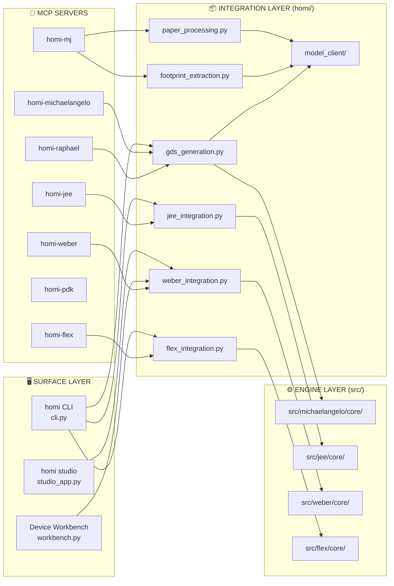

### Integration Modules

| Module | Lines | Purpose |
|--------|-------|---------|
| `paper_processing.py` | ~500 | PDF extraction, scoring, B&W generation |
| `footprint_extraction.py` | ~400 | Dimension extraction from papers |
| `gds_generation.py` | ~900 | Orchestrate Michaelangelo Phase 1 & 2 |
| `jee_integration.py` | ~700 | Parameter optimization via SSE |
| `weber_integration.py` | ~500 | Explorer generation |
| `flex_integration.py` | ~200 | Tidy3D simulation |
| `model_client/` | ~400 | Unified 61-model API |

---

## 3. Michaelangelo Engine - GDS Generation

Multi-seed, multi-turn GDS generation with visual feedback loops.

### Phase 1: Multi-Seed Exploration

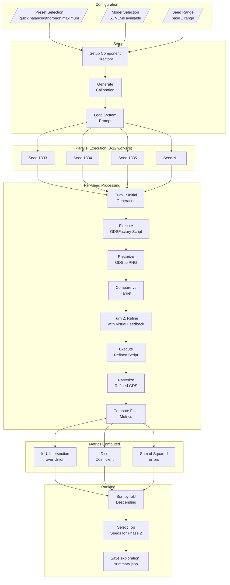

### Phase 2: Extended Iteration

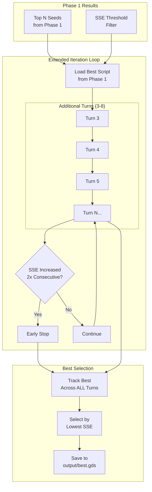

### LLM Interaction Sequence

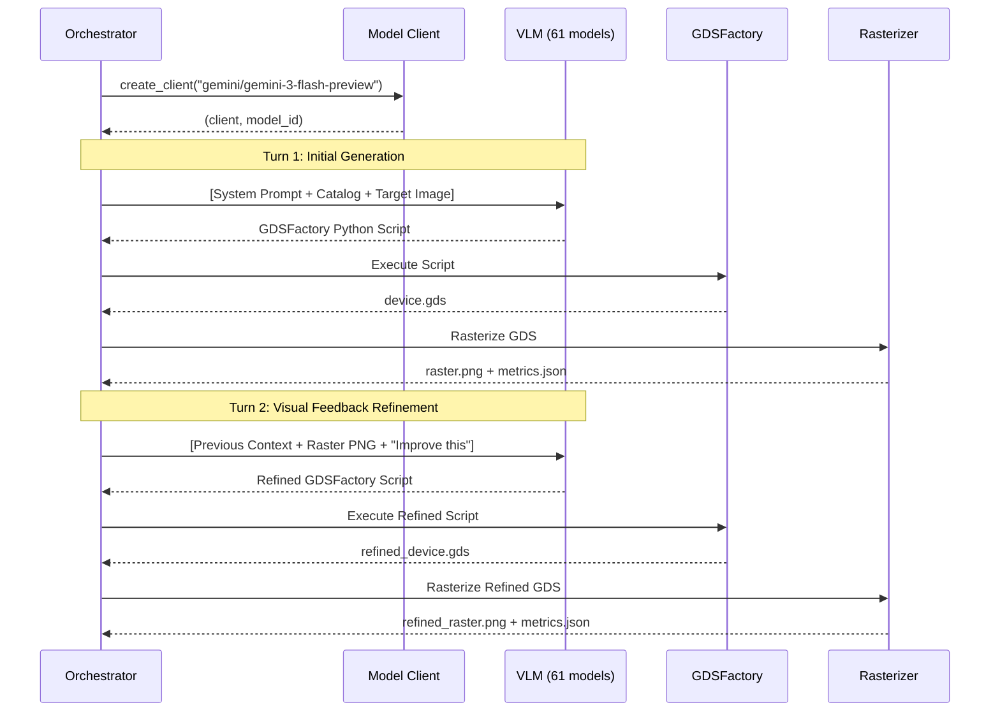

### Generation Presets

| Preset | Seeds | Turns | Parallel | Typical Time |
|--------|-------|-------|----------|--------------|
| `quick` | 5 | 2 | 4 | ~5 min |
| `balanced` | 13 | 3 | 8 | ~10 min |
| `thorough` | 25 | 5 | 8 | ~20 min |
| `maximum` | 41 | 8 | 12 | ~40 min |

---

## 4. JEE Engine - Parameter Optimization

Two-phase optimization: Grid Search + Parallel Multi-Method.

### Optimization Pipeline

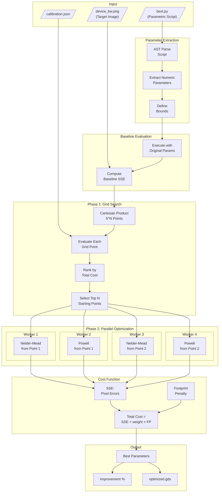

### Cost Function Composition

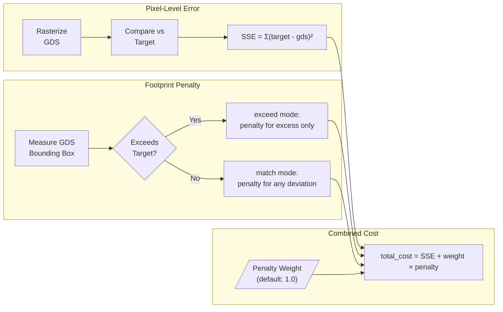

### Optimization Methods Comparison

| Method | Type | Strengths | Best For |
|--------|------|-----------|----------|
| **Nelder-Mead** | Simplex | No gradients needed, robust | Non-smooth surfaces |
| **Powell** | Direction-set | Fast convergence | Smooth functions |
| **CMA-ES** | Evolution | Global search | Multi-modal problems |

---

## 5. MJ Engine - Paper Processing

PDF to B&W device image pipeline.

### Image Extraction & Scoring

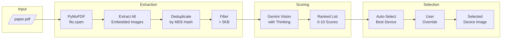

### B&W Variant Generation

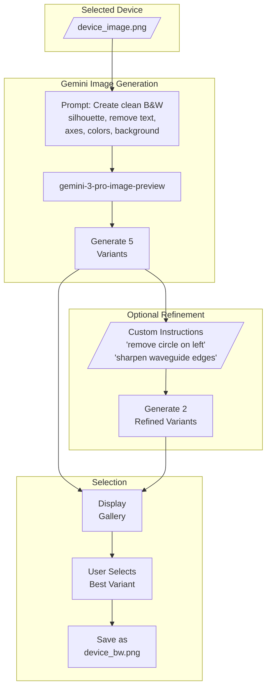

### Footprint Extraction

```mermaid
flowchart TB
    subgraph INPUT["Inputs"]
        PDF[/"paper.pdf"/]
        BW[/"device_bw.png"/]
    end

    subgraph GEMINI["Gemini Extraction"]
        TEXT[Extract PDF<br/>Text (10 pages)]
        VISION[Gemini Vision +<br/>Extended Thinking]
        PARSE_G[Parse μm<br/>Values]
    end

    subgraph MERGE["Validate"]
        VALIDATE[Validate Range<br/>0.01 - 10000 μm]
    end

    subgraph OUTPUT["Output"]
        FOOTPRINT[/"footprint.json<br/>{length_um, width_um}"/]
        USER_CONF[User<br/>Confirmation]
    end

    PDF --> TEXT
    BW --> VISION

    TEXT --> VISION
    VISION --> PARSE_G

    PARSE_G --> VALIDATE
    VALIDATE --> FOOTPRINT
    FOOTPRINT --> USER_CONF
```

---

## 6. Weber Engine - Script Analysis & Device Workbench

AST-based script analysis (`src/weber/core/`: `analyzer`, `config`, `default_slots`) feeding the marimo device workbench: `homi/weber_integration.py` turns a GDSFactory script into slot configuration and a live-knob schema, and `homi/workbench.py` emits a self-contained marimo notebook per device.

### Script Analysis Pipeline

```mermaid
flowchart TB
    subgraph INPUT["Input"]
        SCRIPT[/"best.py<br/>(GDSFactory Script)"/]
    end

    subgraph AST["AST Analysis (weber/core/analyzer.py)"]
        PARSE[ast.parse<br/>Source]
        VISITOR[GDSFactoryVisitor<br/>NodeVisitor]

        subgraph EXTRACT["Extraction"]
            FUNCS[Functions<br/>@gf.cell]
            PARAMS[Numeric<br/>Parameters]
            COMPS[gf.components.*<br/>Calls]
            LAYERS[Layer/Datatype<br/>Tuples]
            CONNS[".connect()<br/>Calls"]
        end
    end

    subgraph SLOTS["Slot Generation (weber/core/default_slots.py + config.py)"]
        GROUP[Group Related<br/>Parameters]
        SWAP[Identify<br/>Swappable Components]
        RANGES[Suggest<br/>Slider Ranges]
        CONFIG[SlotConfig<br/>Object]
    end

    subgraph OUTPUT["Workbench Feed (homi/)"]
        WI_N["weber_integration.py<br/>analyze_and_configure +<br/>get_live_parameter_info"]
        WBGEN["workbench.py<br/>generate_workbench"]
        NB["workbench.py notebook<br/>(marimo, per device)"]
    end

    SCRIPT --> PARSE
    PARSE --> VISITOR
    VISITOR --> FUNCS
    VISITOR --> PARAMS
    VISITOR --> COMPS
    VISITOR --> LAYERS
    VISITOR --> CONNS

    FUNCS --> GROUP
    PARAMS --> GROUP
    COMPS --> SWAP

    GROUP --> CONFIG
    SWAP --> CONFIG
    RANGES --> CONFIG

    CONFIG --> WI_N
    WI_N --> WBGEN
    WBGEN --> NB
```

### Swappable Component Groups

Defined in `weber/core/config.py` (`SWAP_GROUPS`) — only components with compatible parameter signatures are grouped:

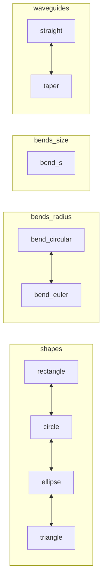

`bend_s` uses `size=(dx, dy)` and is not compatible with the radius-based bends, so it forms its own single-member group.

### The Device Workbench

`homi explore <script> [--launch]` writes `workbench.py` beside the script and serves it with marimo. The generated notebook imports only marimo/anywidget/gdsfactory/PIL/numpy — it stays dependency-free of the repo — and its fidelity readout is the same calibrated-raster IoU the conductor gate uses.

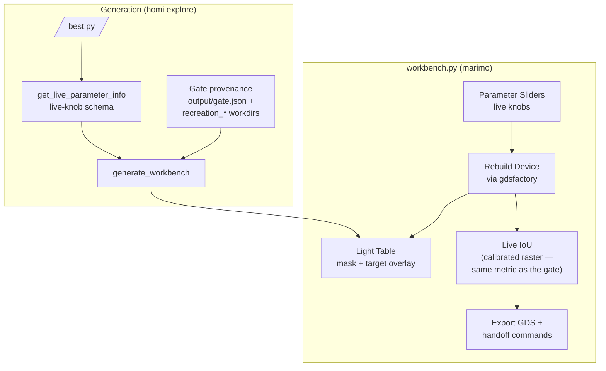

---

## 7. Model Client Architecture

Unified API for 61 vision-language models across 7 providers.

### Provider Backend Pattern

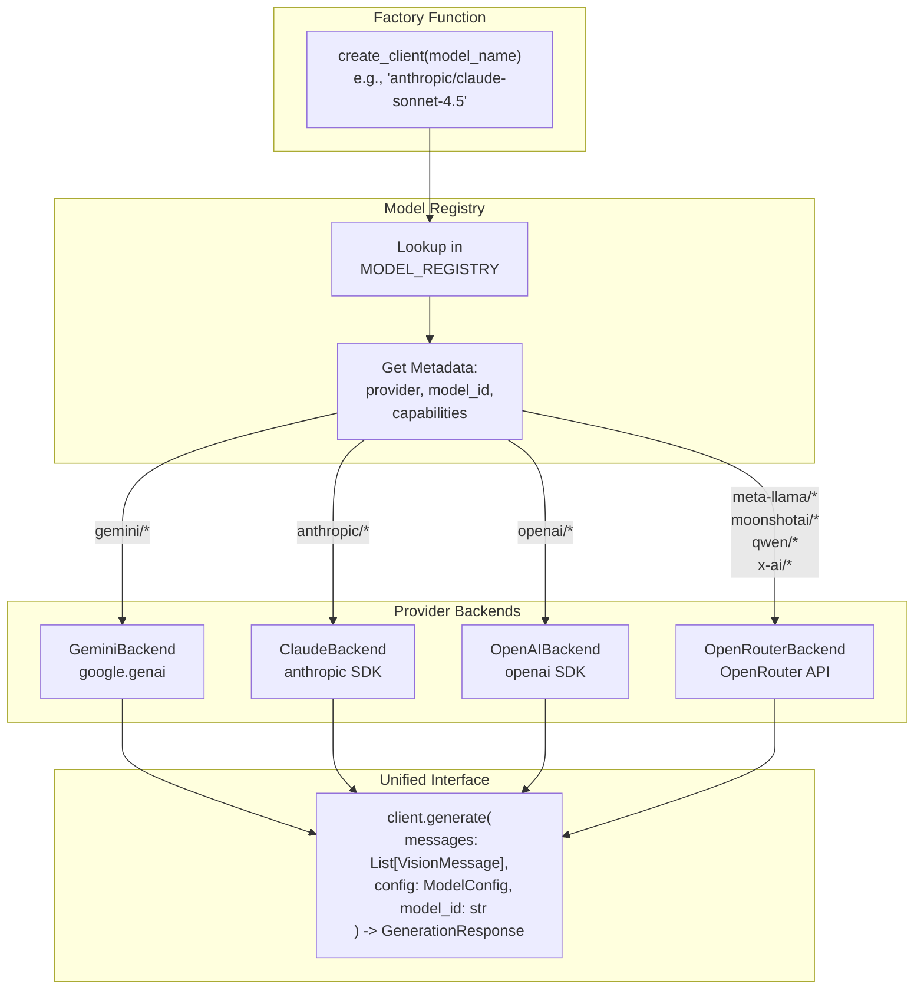

### Core Types

```python
@dataclass
class ModelConfig:
    temperature: float = 1.0
    max_tokens: int = 16000
    seed: Optional[int] = None
    thinking_mode: Optional[str] = None  # "low"|"medium"|"high"
    thinking_budget: Optional[int] = None

@dataclass
class VisionMessage:
    role: str  # "user" | "assistant"
    text: str
    images: List[bytes]
    image_mime_types: List[str]

@dataclass
class GenerationResponse:
    text: str
    raw_response: Any
    usage: Optional[Dict[str, int]]
    thinking_content: Optional[str]
    model_id: Optional[str]
```

### Model Capability Matrix

| Provider | Models | Seed | Thinking | Vision | Max Tokens |
|----------|--------|------|----------|--------|------------|
| **Gemini** | 7 | Yes | Yes | Yes | 65K |
| **Claude** | 9 | No | Yes | Yes | 8K-64K |
| **OpenAI** | 10 | No | Yes | Yes | 16K |
| **Llama** | 4 | Yes | No | Yes | 16K |
| **Kimi** | 4 | Yes | Yes | Yes | 16K |
| **Qwen** | 20 | Yes | Some | Yes | 32K |
| **Grok** | 7 | Yes | Some | Yes | 8K-131K |

### Complete Model List

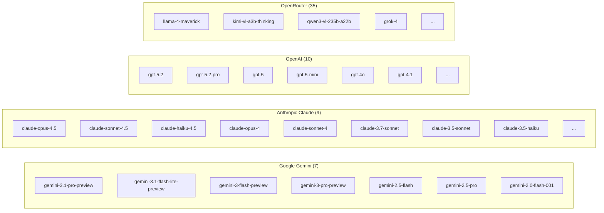

---

## 8. MCP Server Layer

7 servers exposing 65 tools for Claude Code integration.

### Server Architecture

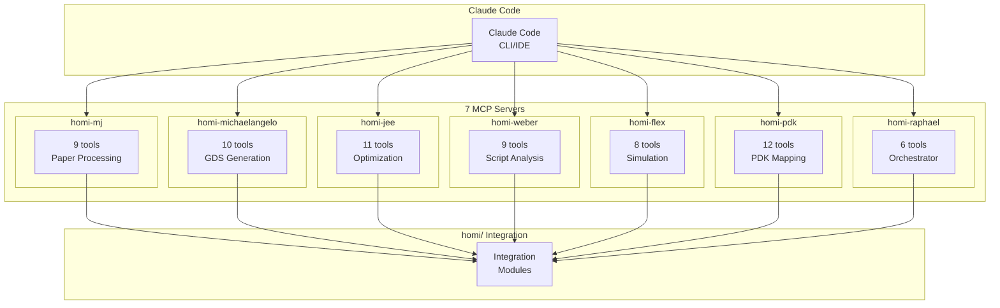

### Async Task Pattern

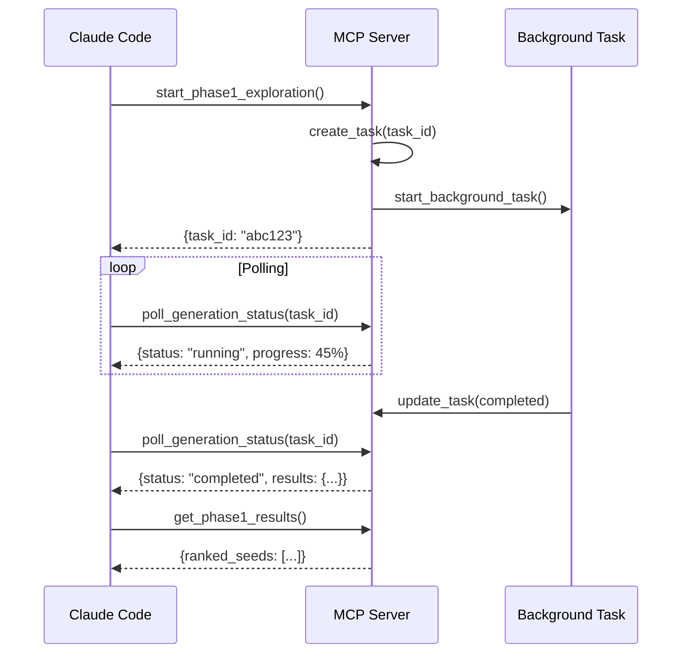

---

## 9. Calibration & Metrics System

Mapping between physical space (μm) and pixel space for accurate comparison.

### Calibration Pipeline

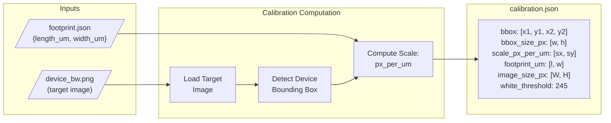

### Scale Factor Calculation

```
scale_px_per_um[X] = bbox_width_px / length_um
scale_px_per_um[Y] = bbox_height_px / width_um
```

### Metric Computation

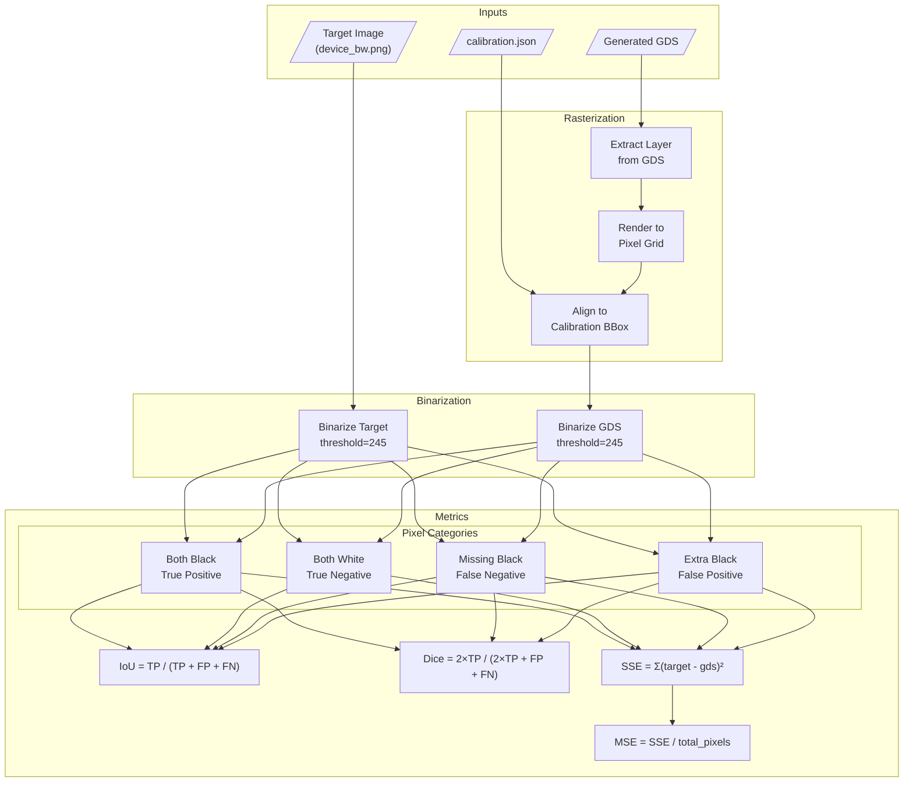

### Metrics Reference

| Metric | Range | Primary Use | Formula |
|--------|-------|-------------|---------|
| **IoU** | 0-1 | Phase 1 Ranking | intersection / union |
| **Dice** | 0-1 | Phase 2 Refinement | 2×intersection / (pred + target) |
| **SSE** | 0-∞ | JEE Optimization | Σ(target_px - gds_px)² |
| **MSE** | 0-1 | Normalized Error | SSE / total_pixels |

---

## 10. Project Structure

Directory layout and artifact generation at each stage.

### Directory Tree

```
projects/{project_name}/
│
├── paper.pdf                          # Step 1: Source paper
│
├── extracted_images/                  # Step 2: All images from PDF
│   ├── page1_img1.png
│   ├── page1_img2.png
│   └── ...
│
├── bw_variants/                       # Step 3: B&W variants
│   ├── variant_1.png
│   ├── variant_2.png
│   └── ...
│
├── device_bw.png                      # Step 3: Selected B&W image
│
├── footprint.json                     # Step 4: Device dimensions
│
├── component/                         # Steps 5-6: Michaelangelo workspace
│   ├── component.png                  # Copy of device_bw.png
│   ├── footprint.json                 # Copy
│   ├── calibration.json               # Pixel↔physical mapping
│   ├── prompt.md                      # Generation system prompt
│   ├── iteration_prompt.md            # Refinement prompt
│   │
│   ├── phase1/                        # Multi-seed exploration
│   │   └── benchmark_{model}/
│   │       └── seed_results/
│   │           └── seed_{N}/
│   │               ├── turn_1/
│   │               │   ├── generated.py
│   │               │   ├── device.gds
│   │               │   ├── raster.png
│   │               │   └── metrics.json
│   │               └── turn_2/
│   │                   └── ...
│   │
│   ├── phase2/                        # Extended iteration
│   │   └── benchmark_{model}/
│   │       └── seed_results/
│   │           └── seed_{N}/
│   │               ├── turn_3/
│   │               ├── turn_4/
│   │               └── ...
│   │
│   └── results/
│       ├── multiturn_seeds/
│       │   └── exploration_summary.json
│       └── extended_iteration/
│           └── extended_exploration_summary.json
│
├── optimization_full/                 # Step 5.5: JEE optimization
│   ├── work/
│   │   ├── iteration_*.json
│   │   └── best_params.json
│   └── output/
│       ├── optimized.py
│       └── optimized.gds
│
├── output/                            # Step 6: Final results
│   ├── best.gds
│   ├── best.py
│   ├── summary.json
│   └── workbench.py                   # Step 7: homi explore (marimo workbench)
│
└── state.json                         # Project state persistence
```

### Artifact Generation Sequence

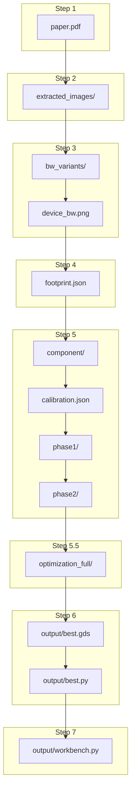

---

## 11. Data Flow Reference

### Key Data Structures

| File | Format | Created At | Schema |
|------|--------|------------|--------|
| `footprint.json` | JSON | Step 4 | `{length_um: float, width_um: float}` |
| `calibration.json` | JSON | Step 5 setup | `{bbox, bbox_size_px, scale_px_per_um, footprint_um, image_size_px, white_threshold}` |
| `metrics.json` | JSON | Each turn | `{IoU, Dice, SSE, MSE, Accuracy, Precision, Recall, total_pixels, gds_size_um, size_match}` |
| `exploration_summary.json` | JSON | Phase 1 end | `{seed_results: [{seed, turn1_*, turn2_*, metrics}]}` |
| `state.json` | JSON | Throughout | `{step, timestamps, selections, paths}` |

### Stage-by-Stage Data Flow

| From | To | Data | Format |
|------|-----|------|--------|
| PDF | Extraction | Raw images | PNG |
| Images | Scoring | Scores | 0-10 float |
| Selected | B&W Gen | Variants | PNG |
| B&W + Paper | Footprint | Dimensions | μm values |
| B&W + Footprint | Calibration | Mapping | JSON |
| Calibration + Prompt | Phase 1 | GDS scripts | Python |
| Phase 1 | Phase 2 | Top seeds | Seed list |
| Phase 2 | JEE | Best script | Python |
| JEE | Output | Optimized | GDS + Python |
| Output | Weber | Workbench | marimo notebook |
| GDS | Flex | Simulation | Task ID |

---

## 12. Complete Tool Reference

### homi-mj (9 tools)

| Tool | Input | Output | Purpose |
|------|-------|--------|---------|
| `extract_images_from_pdf` | pdf_path, output_dir | List[{path, page, size}] | Extract embedded images, dedup by content hash |
| `generate_bw_variants` | image_path, num_variants | List[variant_paths] | Create B&W silhouettes via Gemini image generation |
| `refine_bw_image` | source_image_path, custom_instructions | List[refined_paths] | Refine a B&W image per custom instructions |
| `compute_image_similarity` | image1_path, image2_path | {SSIM, MSE, ...} | Compare two images |
| `get_image_metadata` | image_path | {dims, format, mode} | Image dimensions, format, color mode, size |
| `render_pdf_pages` | pdf_path, pages, scale | List[page_images] | Render full pages incl. vector graphics |
| `analyze_pdf_figures` | pdf_path | per-page counts + recommend_render | Per-page diagnostic, no API calls: embedded-image + vector-draw-op counts |
| `crop_region` | page_image_path, x1, y1, x2, y2 | cropped_image | Crop a region you located yourself, no API calls |
| `create_footprint_json` | length_um, width_um, output_path | footprint.json | Create footprint file for calibration |

### homi-michaelangelo (10 tools)

| Tool | Input | Output | Purpose |
|------|-------|--------|---------|
| `setup_component_directory` | image, output_dir, footprint | component/ dir | Initialize workspace |
| `run_calibration` | component_dir | calibration.json | Generate calibration |
| `start_phase1_exploration` | component_dir, preset, model | task_id | Start multi-seed |
| `poll_generation_status` | task_id | {status, progress} | Check progress |
| `get_phase1_results` | component_dir | ranked_seeds | Get Phase 1 results |
| `start_phase2_iteration` | component_dir, seeds | task_id | Start extended |
| `get_phase2_results` | component_dir | best_result | Get Phase 2 results |
| `get_generation_metrics` | component_dir | all_metrics | IoU/Dice for all seeds, diff images, rasters |
| `list_presets` | - | presets | Available generation presets |
| `list_available_models` | provider? | models | List all available models (61 across 7 providers) |

### homi-jee (11 tools)

| Tool | Input | Output | Purpose |
|------|-------|--------|---------|
| `extract_parameters` | script_path | List[{name, value, bounds}] | Find tunable numeric params + suggested bounds |
| `compute_sse` | target_image, raster_image | {SSE, MSE, RMSE} | Pixel error between target and rasterized GDS |
| `run_optimization` | script, target, calib, bounds | task_id | Start SSE minimization (long-running) |
| `poll_optimization` | task_id | {status, iteration, sse} | Check optimization progress |
| `get_optimization_result` | task_id | {best_params, improvement} | Final params, SSE, improvement % |
| `apply_parameters` | script, params | {script_path, gds_path} | Apply params, regenerate GDS |
| `prepare_calibration` | target_image, footprint_json | calibration.json | μm↔px mapping for SSE comparison |
| `get_optimization_config` | - | default config | Documented defaults (max_iterations, method, penalty) |
| `run_exploration` | script, target, calib | task_id | Grid search + parallel Powell/Nelder-Mead |
| `poll_exploration` | task_id | {status} | Check exploration progress |
| `get_exploration_result` | task_id | {best_result, comparison} | Best result across all methods |

### homi-weber (9 tools)

| Tool | Input | Output | Purpose |
|------|-------|--------|---------|
| `analyze_script` | script_path | ScriptAnalysis | AST parse: components, params, layers, functions |
| `detect_swappable_components` | analysis | swappable_groups | Find alternatives (e.g. bend_circular ↔ bend_euler) |
| `generate_slot_definitions` | analysis, output_path | slot_definitions.py | Semantic slot grouping of parameters |
| `validate_explorer` | app_path | {valid, errors} | Syntax/import check of generated code |
| `get_parameter_suggestions` | parameters | suggested_ranges | Slider ranges from values + photonics patterns |
| `build_device_with_params` | script, params | component info (+ GDS) | Execute script with injected slider values |
| `analyze_and_configure` | script_source or script_path | analysis + slot_config | Full analyzer → UI-ready slot configuration |
| `build_component_map` | slot_config | component_map | Slot IDs → component IDs for swapping |
| `build_device_slots_dict` | slot_config | device slots dict | Layer-assignment UI structure |

### homi-flex (8 tools)

| Tool | Input | Output | Purpose |
|------|-------|--------|---------|
| `is_tidy3d_available` | - | {available, version} | Check Tidy3D install |
| `get_material_presets` | - | List[presets] | Core/cladding refractive indices |
| `validate_api_key` | api_key | {valid} | Check authentication |
| `get_simulation_info` | gds_path | {layers, bounds} | Sim parameters without creating or uploading |
| `create_and_upload_simulation` | gds, api_key, material | {task_id, url} | Upload to cloud; returns Workbench URL |
| `run_parameter_sweep` | script, stack_json, sweep, fom, budget_fc | sweep results | Budgeted measure-only FDTD grid over declared tunables (dry_run preview) |
| `get_task_status` | task_id | {status} | queued / running / success / error |
| `get_workbench_url` | task_id | url | Tidy3D Workbench link |

### homi-pdk (12 tools)

| Tool | Input | Output | Purpose |
|------|-------|--------|---------|
| `analyze_paper_process` | paper_text or pdf_path | process_info | Extract thickness, materials, wavelength, foundry hints |
| `list_available_pdks` | - | List[pdks] | Available PDKs with specifications |
| `match_pdk` | process_info | ranked_matches | Compatible PDKs with confidence scores |
| `get_pdk_layer_mapping` | pdk_name | layer_map | Generic → PDK layers |
| `convert_to_pdk` | gds, pdk, output | converted.gds | Apply PDK layers |
| `run_drc` | gds, pdk | List[violations] | Design rule check with locations |
| `suggest_drc_fixes` | violations | List[suggestions] | Fix suggestions |
| `parse_pdk_document` | pdf_path | structured PDK definition | Layers, materials, cross-sections, rules from a foundry PDF |
| `load_builtin_pdk` | pdk_name | PDK definition | Load a pre-defined builtin PDK by name |
| `list_pdk_layers_full` | pdk_name | layer list | Complete material + geometry properties per layer |
| `get_layer_material_properties` | pdk_name, layer_name | material properties | Tidy3D-compatible indices for a PDK layer |
| `get_pdk_cross_sections` | pdk_name | cross-sections | Film/etch/slab thickness, sidewall angles |

### homi-raphael (6 tools)

| Tool | Input | Output | Purpose |
|------|-------|--------|---------|
| `setup_component_directory` | image, output, footprint | component/ | Initialize workspace |
| `run_calibration` | component_dir | calibration.json | Generate calibration |
| `execute_gds_script` | script_path | gds_path | Run GDSFactory script |
| `rasterize_and_compare` | gds, target, calib | {IoU, Dice, SSE} | IoU (the cost function) vs target |
| `get_gds_catalog` | extended? | catalog | GDSFactory function reference |
| `get_target_image` | component_dir | {image, footprint, calibration} | Get target info |

---

## Legend

### Diagram Symbols

| Symbol | Meaning |
|--------|---------|
| `[/text/]` | File/Data Input |
| `[text]` | Process/Action |
| `{text}` | Decision Point |
| `[(text)]` | Database/Storage |
| `((text))` | Circle: Start/End |

### Color Coding

| Color | Meaning |
|-------|---------|
| Blue | Input/Data |
| Orange | Processing |
| Pink | Decision |
| Green | Output |
| Purple | Engine/Core Process |

---

## Quick Reference

### Environment Variables

```bash
GEMINI_API_KEY=...        # Required for Gemini models
ANTHROPIC_API_KEY=...     # Required for Claude models
OPENAI_API_KEY=...        # Required for GPT models
OPENROUTER_API_KEY=...    # Required for Llama/Kimi/Qwen
TIDY3D_API_KEY=...        # Required for simulation
```

### Key Commands

```bash
# Launch the studio (chat front door + light table)
homi studio

# Generate + serve the device workbench for a script
homi explore projects/{name}/output/best.py --launch

# MCP servers: .mcp.json binds the console scripts
# (.venv/bin/homi-mj ... .venv/bin/homi-pdk, via gg.servers.entry_points)
.venv/bin/homi-mj

# the module form also works
.venv/bin/python -m gg.servers.mj_server
.venv/bin/python -m gg.servers.michaelangelo_server
.venv/bin/python -m gg.servers.raphael_server
.venv/bin/python -m gg.servers.jee_server
.venv/bin/python -m gg.servers.weber_server
.venv/bin/python -m gg.servers.flex_server
.venv/bin/python -m gg.servers.pdk_server
```

### Critical Dependencies

- **GDSFactory**: Pinned to 9.20.7 (9.3x+ has breaking API changes)
- **Python**: >=3.11,<3.14 required

---

*Generated for PixCell v1.0 (engine package: `homi`) - Photonic Multimodal Intelligence*
