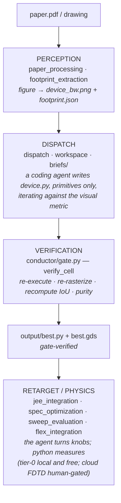

# homi — the engine hub

Every surface (`pixcell`/`homi` CLI, the studio, the workbench, the MCP
servers) calls into this package. Two invariants govern everything here,
and they are code, not convention:

1. **The agent is the optimizer; the Python only measures — it never searches.**
2. **No worker-reported number enters the record** — acceptance is always the
   deterministic conductor gate over artifacts (`homi.conductor.verify_cell`).

## How a run flows



## Map

```text
homi/
├── cli.py                 The pixcell/homi command — every stage as a subcommand
├── studio_app.py          Chat conductor + live light table (marimo)
├── workbench.py           Per-device explorer: mask, knobs, live IoU (marimo)
│
├── paper_processing.py    PDF → figure panels → B&W silhouette (the one Gemini call)
├── footprint_extraction.py  Physical dimensions → footprint.json
│
├── dispatch.py            Send a brief to a worker agent; success = artifacts on disk
├── workspace.py           Where workers run: tmux session, or headless claude/codex
├── briefs/                The worker prompts as versioned package data — the
│                          protocol's payload, hint-linted (extract / phase A / phase B)
│
├── conductor/             The gate and its instruments
│   ├── gate.py            verify_cell: re-execute, re-rasterize, recompute, purity
│   ├── hint_lint.py       Keeps briefs free of geometry hints
│   ├── measure.py         Spend-capped MEASURE handshake for retargeting
│   ├── tier1.py           Capped FDTD harness
│   └── promote.py · fom.py · metrics.py · readback.py
│
├── jee_integration.py     Optimizer bridge (knob extraction, SSE runs, promotion)
├── spec_optimization.py   Tier-0 physics evaluator — measures, never searches
├── sweep_evaluation.py    Budgeted batch-sweep measurement
├── flex_integration.py    Tidy3D bridge (cloud spend is human-gated)
│
├── gds_generation.py      The --baseline multi-seed driver (the paper's
├── exploration_tree.py      measured chatbot-style baseline, kept reproducible)
├── benchmark/             Chatbot-benchmark statistics library — recomputes
│                          the paper's baseline numbers from the raw record
├── model_client/          Unified "provider/model" VLM client, lazy backends
│
├── paths.py               Portable root/state resolution (checkout, install, env)
├── projects.py            Project-directory state (the directory is the state)
├── doctor.py              Preflight: what can run here, what to add
├── weber_integration.py   Knob analysis for the workbench and optimizer
├── footprint_verification.py  Optional calibration self-test (see michaelangelo docs)
├── optional_deps.py       Graceful handling of optional heavy imports
├── assets/                Package data: foundry stack JSONs + the worked-example seed
└── api.py                 REST surface over the same stages (local use)
```
